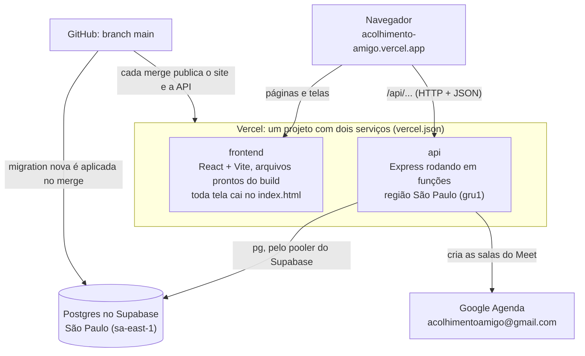
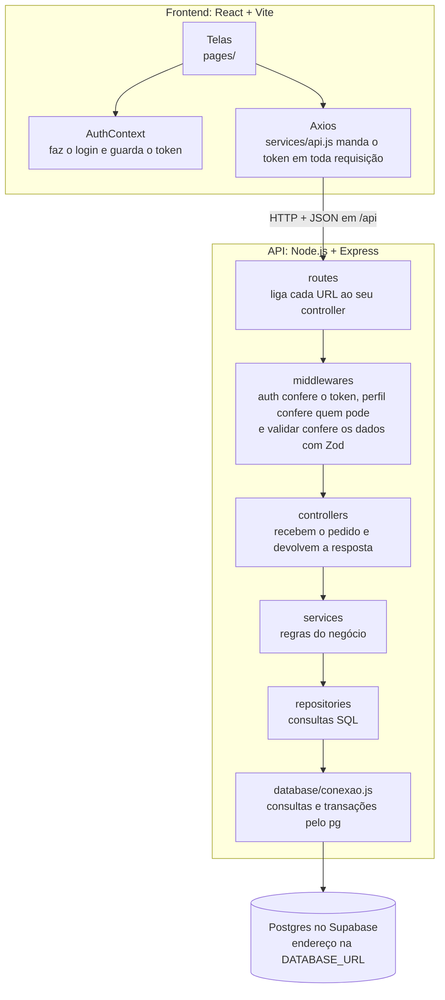
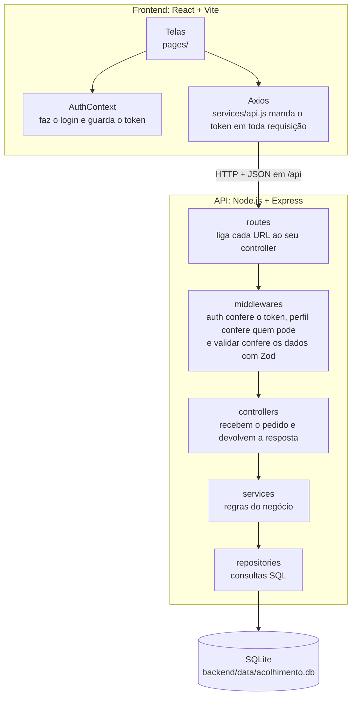
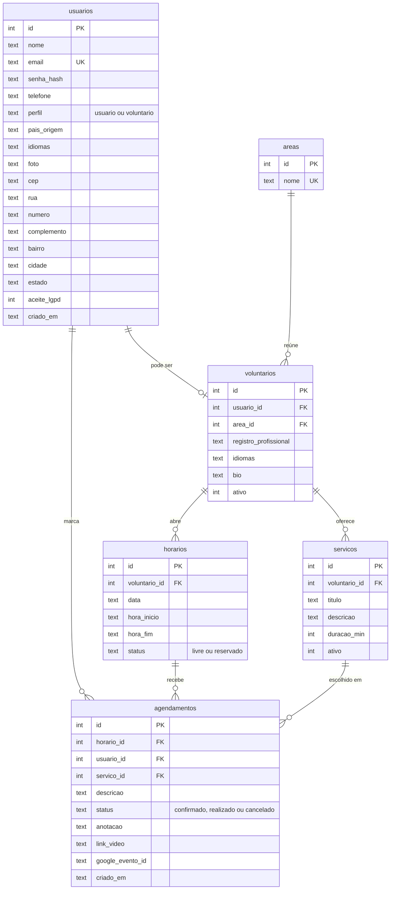

# Acolhimento Amigo

Plataforma web gratuita que conecta migrantes e refugiados a profissionais voluntários para atendimentos online: orientação jurídica, psicologia, assistência social, aulas de português, saúde, moradia e apoio para trabalho e carreira.

Projeto final do curso Full Stack da Toti, turma 58, grupo 5.

## Acesse online

- **Site em produção:** https://acolhimento-amigo.vercel.app
- **Vídeo de demonstração (2 min):** [assistir no Google Drive](https://drive.google.com/file/d/1UDJVzRwmNNQJDGGo47wl7meuq6ApEuRL/view?usp=sharing)
- **Slides da apresentação:** [apresentacao-grupo-5.pdf](docs/apresentacao-grupo-5.pdf)

Para entrar no site sem criar conta, use um dos usuários de teste (senha de todos: `senha123`):

| Perfil | E-mail |
| --- | --- |
| Usuário | `usuario@teste.com` |
| Voluntário (Jurídico) | `voluntario@teste.com` |

Para ver o projeto, não precisa instalar nada. A seção **Como rodar** é para quem vai programar.

## User stories

Cada ação mostra a rota da API que ela usa. A coluna **Situação** diz em que pé está:

- **Pronto**: a tela e a API funcionam
- **Só na API**: a rota já funciona, falta a tela
- **Falta a tela**: ainda não foi feita

| Como um | eu posso... | | Rota da API | Situação |
| --- | --- | --- | --- | --- |
| Visitante | eu posso... | Conhecer o Acolhimento Amigo e as áreas de atendimento | Não usa a API | Pronto |
| Visitante | eu posso... | Criar uma conta como usuário para pedir atendimento | `POST /auth/cadastro` | Pronto |
| Visitante | eu posso... | Criar uma conta como voluntário informando minha área de atuação | `GET /areas`, `POST /auth/cadastro` | Pronto |
| Visitante | eu posso... | Entrar com meu e-mail e senha | `POST /auth/login` | Pronto |
| Usuário (logado) | eu posso... | Buscar voluntários por palavra-chave | `GET /voluntarios?q=` | Pronto |
| Usuário (logado) | eu posso... | Filtrar voluntários por área, idioma e disponibilidade | `GET /voluntarios?area=&idioma=&disponivel=` | Pronto |
| Usuário (logado) | eu posso... | Ver o perfil do voluntário com os serviços e os horários livres | `GET /voluntarios/:id` | Pronto |
| Usuário (logado) | eu posso... | Marcar um horário livre escolhendo o serviço e contando o que preciso | `POST /agendamentos` | Pronto |
| Usuário (logado) | eu posso... | Ver meus atendimentos marcados e os que já passaram | `GET /meus-agendamentos` | Pronto |
| Usuário (logado) | eu posso... | Remarcar um atendimento para outro horário do mesmo voluntário | `PUT /agendamentos/:id` | Só na API |
| Usuário (logado) | eu posso... | Cancelar um atendimento | `DELETE /agendamentos/:id` | Pronto |
| Usuário (logado) | eu posso... | Entrar na videochamada no dia do atendimento | `POST /agendamentos/:id/videochamada` | Pronto |
| Usuário (logado) | eu posso... | Editar meus dados e colocar minha foto | `GET /me`, `PUT /me` | Pronto |
| Usuário (logado) | eu posso... | Excluir minha conta | `DELETE /me` | Pronto |
| Voluntário (logado) | eu posso... | Ver no painel meu próximo atendimento e os números do mês | `GET /meus-agendamentos`, `GET /meus-horarios` | Pronto |
| Voluntário (logado) | eu posso... | Cadastrar, editar e excluir os serviços que ofereço | `GET /meus-servicos`, `POST /servicos`, `PUT /servicos/:id`, `DELETE /servicos/:id` | Pronto |
| Voluntário (logado) | eu posso... | Abrir os dias e horários em que posso atender | `POST /horarios`, `DELETE /horarios/:id` | Pronto |
| Voluntário (logado) | eu posso... | Ver minha agenda em calendário por mês, semana e dia | `GET /meus-horarios` | Pronto |
| Voluntário (logado) | eu posso... | Ver o caso e o contato de quem marcou comigo | `GET /meus-agendamentos` | Pronto |
| Voluntário (logado) | eu posso... | Concluir um atendimento escrevendo o que foi feito e o próximo passo | `PUT /agendamentos/:id` | Pronto |
| Voluntário (logado) | eu posso... | Cancelar um atendimento | `DELETE /agendamentos/:id` | Pronto |
| Voluntário (logado) | eu posso... | Ver meu histórico filtrando realizados e cancelados | `GET /meus-agendamentos` | Pronto |
| Voluntário (logado) | eu posso... | Buscar nos relatórios quem atendi por nome, data, serviço e nacionalidade | `GET /meus-agendamentos` | Pronto |
| Voluntário (logado) | eu posso... | Escolher se apareço ou não na busca | `PUT /me` | Pronto |
| Voluntário (logado) | eu posso... | Editar meus dados, foto, idiomas e apresentação | `GET /me`, `PUT /me` | Pronto |
| Voluntário (logado) | eu posso... | Excluir minha conta | `DELETE /me` | Pronto |

## Tecnologias

- Backend: Node.js, Express, Zod, bcrypt e JWT
- Banco: PostgreSQL (no Supabase) com o pacote pg
- Frontend: React + Vite, React Router e Axios
- Publicação: Vercel (site e API num projeto só) e Supabase (banco)

## Arquitetura

### Em produção

O site e a API ficam num projeto só do Vercel, no mesmo endereço: o que começa com `/api/` vai para o Express, e o resto é o site em React. A API roda em São Paulo, perto do banco, que é um Postgres no Supabase.



### Por dentro do código

O frontend em React roda no navegador e conversa com a API só por HTTP, em JSON. A API em Node.js e Express é a única parte que mexe no banco. É assim no site publicado e no `npm run dev`.



Se algo falha no caminho, a API para ali e responde `{ erro, detalhes }`: `401` sem token, `403` com o perfil errado, `400` com dados inválidos e `409` quando uma regra não deixa (por exemplo, horário que acabou de ser reservado).

### Primeira versão (SQLite, só local)

Até 03/11/2026 o projeto rodava só no computador de cada um, e o banco era um arquivo SQLite (`backend/data/acolhimento.db`), lido pelo `better-sqlite3`. Para publicar, o banco passou para o Postgres do Supabase: no Vercel a API roda em funções que não guardam arquivo, e um banco em arquivo se perderia. Os dados do SQLite foram copiados para o Supabase com os mesmos ids.



### Fluxo de um atendimento

1. O voluntário cria a conta escolhendo a área, cadastra os serviços que oferece e abre os horários em que pode atender.
2. O usuário cria a conta e busca voluntários por palavra-chave, área, idioma e disponibilidade.
3. No perfil do voluntário, escolhe um horário livre e um serviço e conta o que precisa.
4. A API confere se o horário ainda está livre, se o serviço é daquele voluntário e se a pessoa não tem outro atendimento no mesmo horário. Numa única transação no Postgres, cria o agendamento como `confirmado` e muda o horário para `reservado`. Depois, com o Google configurado, cria a sala do Google Meet do atendimento.
5. O voluntário vê o atendimento no painel e na agenda, com o caso e o contato da pessoa. Os dois entram pelo botão **Entrar na videochamada**, que libera 10 minutos antes do horário.
6. Depois da conversa, o voluntário conclui o atendimento (`realizado`) e escreve a anotação, que o usuário também lê.
7. Se um dos dois cancelar antes, o agendamento vira `cancelado` e o horário volta a ficar `livre` para outra pessoa.

## Como rodar

Precisa ter o Node.js (versão LTS) e o Git instalados.

### Primeira vez

```bash
git clone https://github.com/luisquesada26/acolhimento-amigo.git
cd acolhimento-amigo
npm run install:all
cp backend/.env.example backend/.env    # no Windows: copy backend\.env.example backend\.env
# coloque no backend/.env a DATABASE_URL que o Luis passa em particular
npm run dev
```

O `npm run dev` sobe as duas partes juntas:

| Parte | Endereço |
| --- | --- |
| Frontend (React) | `http://localhost:5173/login` |
| API (Express) | `http://localhost:3000/api` (teste em `/api/saude`) |

Para entrar, use um dos usuários de teste abaixo ou crie uma conta nova como usuário ou como voluntário.

### Um banco só, o do site

Existe um banco só: o Postgres do Supabase que o site usa. **O `npm run dev` de todo mundo grava nele**, então o que você cria, edita ou apaga testando aparece no site. O plano Free do Supabase não tem backup: o que for apagado não volta.

### Dia a dia

1. `git checkout main` e `git pull`
2. `git checkout -b feature/nome-da-tarefa`
3. Se o `package.json` mudou, rodar `npm run install:all`
4. Programar e testar com `npm run dev`
5. `git add .`, `git commit -m "feat(xx): ..."` e `git push`
6. Abrir o pull request para a `main` e esperar a aprovação do Luis

### Videochamada (Google Meet)

É opcional: sem ela, o agendamento funciona igual e o botão **Entrar na videochamada** avisa que a videochamada não está configurada.

Com ela, cada atendimento marcado ganha uma sala do Google Meet. A sala é um evento na agenda da conta do projeto, `acolhimentoamigo@gmail.com`, com o usuário e o voluntário como convidados. Remarcar muda o horário da sala, e cancelar apaga. Os agendamentos que já existiam (os do seed) ganham a sala no primeiro clique no botão.

Para ligar no seu computador:

1. Peça ao Luis o ID e o segredo do cliente do Google e coloque no `backend/.env`, nas linhas `GOOGLE_CLIENT_ID` e `GOOGLE_CLIENT_SECRET` (o `backend/.env.example` mostra o formato). Nunca no GitHub.
2. Na pasta `backend`, rode `npm run google:autorizar`. O navegador abre: entre com `acolhimentoamigo@gmail.com`, marque a permissão da agenda e clique em **Continuar**. O comando grava o `GOOGLE_REFRESH_TOKEN` no `.env`.
3. Reinicie o `npm run dev`.

Enquanto o app do Google estiver em modo de teste, a autorização vence em 7 dias: aí é só rodar o passo 2 de novo.

No Meet, entra direto quem está convidado e logado no Google com aquele e-mail, ou a própria conta do projeto. Os e-mails do seed são de mentira, então na demonstração uma pessoa abre a sala logada com `acolhimentoamigo@gmail.com`. O convite por e-mail fica desligado (`GOOGLE_ENVIAR_CONVITES=false`), para não mandar e-mail para endereços que não existem.

## Banco de dados

O banco é o PostgreSQL do Supabase, o mesmo do site, e a `DATABASE_URL` do `backend/.env` aponta para ele. Não existe comando para recriar o banco: o `npm run dev` de todo mundo grava nos dados de verdade, e o plano Free não tem backup.

O schema fica em `supabase/migrations/`. O primeiro arquivo, `20261103120000_schema_inicial.sql`, é o schema com que o banco nasceu. **Mudança de schema é um arquivo novo nessa pasta, numa pull request**, e ele é aplicado no banco quando entra na `main`, pela integração. Nunca edite uma migration que já entrou.

As senhas são salvas com bcrypt, nunca em texto puro.

Algumas escolhas do schema inicial:

- datas e horas ficam em texto (`'2026-11-04'`, `'14:00'`) e os campos de sim ou não em `0` e `1`, do jeito que o frontend já recebia do SQLite
- os nomes e os textos da busca usam `COLLATE "C"`, para a ordem e a busca serem as mesmas em qualquer servidor
- a RLS fica ligada em todas as tabelas, sem nenhuma regra: a API entra como dona das tabelas e não é barrada, e a API automática do Supabase (Data API) fica fechada para quem tiver a chave pública

Só quem cuida do banco cria migration. Toda migration vai em um pull request próprio.

### Tabelas

| Tabela | Colunas principais | Para que serve |
| --- | --- | --- |
| `usuarios` | `nome`, `email`, `senha_hash`, `telefone`, `perfil`, `pais_origem`, `idiomas`, `foto`, `cep`, `rua`, `numero`, `complemento`, `bairro`, `cidade`, `estado` | Todas as contas. O `perfil` diz se a pessoa é usuário ou voluntário. O endereço é opcional e só a própria pessoa vê |
| `areas` | `nome` | As áreas de atendimento: Jurídico, Psicologia, Moradia e as outras |
| `voluntarios` | `usuario_id`, `area_id`, `registro_profissional`, `idiomas`, `bio`, `ativo` | Dados profissionais de quem é voluntário. Com `ativo` desligado, não aparece na busca |
| `servicos` | `voluntario_id`, `titulo`, `descricao`, `duracao_min`, `ativo` | O que cada voluntário oferece |
| `horarios` | `voluntario_id`, `data`, `hora_inicio`, `hora_fim`, `status` | A agenda do voluntário: cada horário está `livre` ou `reservado` |
| `agendamentos` | `horario_id`, `usuario_id`, `servico_id`, `descricao`, `status`, `anotacao`, `link_video`, `google_evento_id` | Junta quem marcou, o horário e o serviço. Fica `confirmado`, `realizado` ou `cancelado` |



### Usuários de teste

Estão em [Acesse online](#acesse-online), no começo deste README.

## Organização no GitHub

- `main`: a única branch fixa, com a versão que vai ser apresentada
- `feature/nome-da-tarefa` e `fix/nome-do-erro`: uma branch por tarefa, criada a partir da `main`
- Ninguém faz push direto na `main`. Tudo entra por pull request, e só o Luis aprova
- Na descrição do pull request, escrever `Closes #12` com o número da tarefa: no merge a tarefa fecha sozinha. Tem que ser em inglês (`Closes`, `Fixes` ou `Resolves`), o GitHub não entende `Fecha`
- Depois do merge, a branch da tarefa é apagada

### Padrão de commits

Tipo, iniciais de quem fez entre parênteses e a descrição:

```
feat(lq): cria crud de horarios
fix(lq): corrige conflito de agendamento
docs(lq): atualiza readme
refactor(lq): separa services do controller
chore(lq): atualiza dependencias
```

## API

As rotas estão em [docs/api.md](docs/api.md).

Para testar pelo VS Code, instale a extensão **REST Client**, rode `npm run dev`, abra o arquivo [backend/api.http](backend/api.http) e clique em **Send Request** em cima de cada requisição. Rode primeiro os logins: o token é usado sozinho nas rotas que precisam dele.

Para usar pelo Postman, importe a coleção [docs/acolhimento-amigo.postman_collection.json](docs/acolhimento-amigo.postman_collection.json), com `npm run dev` rodando:

- tem GET, POST, PUT e DELETE de cada tabela, uma pasta por tabela
- não precisa fazer login: antes de cada envio a coleção entra sozinha com os usuários de teste
- PUT e DELETE trabalham no que o POST da mesma pasta criou (se não tiver, a coleção cria na hora), então os dados do seed não são apagados
- se alguma requisição der 401 ou 404 (token vencido ou item já apagado), é só mandar de novo
- quando a coleção mudar, importe de novo e escolha **Replace** para substituir a antiga

Os casos de erro (403, 409, dados inválidos) ficam no `api.http`.

**Atenção:** o `npm run dev` grava no banco do site, então o `api.http` e a coleção criam, editam e apagam dados de verdade. O `api.http` usa ids fixos (como `DELETE /servicos/121` e `DELETE /horarios/1?confirmar=true`), que hoje podem ser dados reais.

## Como está publicado

- **Vercel:** o projeto `acolhimento-amigo` usa a raiz do repositório com o preset **Services**. O `vercel.json` da raiz tem dois serviços: o `api` (pasta `backend`, Express, entrada `src/app.js`) recebe o que começa com `/api/`, com o caminho inteiro, e o `frontend` (pasta `frontend`, Vite) recebe o resto. As funções rodam em São Paulo (`gru1`). Cada merge na `main` publica sozinho, e cada pull request ganha um endereço de preview.
- **Supabase:** o banco fica em São Paulo (`sa-east-1`). A Data API está desligada e a RLS ligada em todas as tabelas, sem regras. A integração com o GitHub aplica no banco cada migration nova de `supabase/migrations/` quando ela entra na `main`.

Variáveis do projeto no Vercel:

| Variável | Valor |
| --- | --- |
| `DATABASE_URL` | o endereço do banco no Supabase (Transaction pooler, porta 6543) |
| `JWT_SECRET` | um segredo só da produção, diferente do de desenvolvimento |
| `VITE_API_URL` | `/api`, porque o site e a API ficam no mesmo endereço |
| `GOOGLE_CLIENT_ID`, `GOOGLE_CLIENT_SECRET`, `GOOGLE_REFRESH_TOKEN` | as chaves da videochamada |

O `CORS_ORIGIN` não precisa: no mesmo endereço o navegador não confere o CORS.

### O que mudou no código para publicar

- **Conexão:** o `pg` no lugar do `better-sqlite3`, com a `DATABASE_URL`. O `backend/src/database/conexao.js` tem a `consulta(sql, params)`, que troca os `?` por `$1`, `$2`..., e a `transacao(fn)`, que faz `BEGIN`, `COMMIT` e, se der erro, `ROLLBACK`
- **Consultas assíncronas:** o Postgres responde depois, então repositories, services e controllers usam `async`/`await`
- **SQL do Postgres:** `GENERATED BY DEFAULT AS IDENTITY` no lugar do `AUTOINCREMENT`, `RETURNING id` no lugar do `lastInsertRowid`, `ILIKE` na busca (o `LIKE` do Postgres diferencia maiúsculas) e `COUNT(*)::int` (o `pg` devolve a contagem como texto)
- **Fuso horário:** o servidor do Vercel roda em UTC e não deixa trocar o `TZ`, então o `backend/src/utils/datas.js` calcula a data e a hora com `timeZone: "America/Sao_Paulo"`. Sem isso, o `agora()` ficaria 3 horas adiantado e os horários das próximas 3 horas apareceriam como já passados
- **Rotas do React:** no serviço `frontend`, toda rota cai no `index.html`, senão um F5 em `/login` daria 404
- **Corridas:** no SQLite cada gravação acontecia inteira, sem nada no meio. No Postgres, as gravações que conferem e depois gravam usam travas na transação (`pg_advisory_xact_lock` e `FOR UPDATE`), para dois cliques quase juntos não passarem pela mesma conferência

## Próximos passos

O que fica para depois da entrega:

- Videochamada dentro do próprio site
- Remarcar o atendimento pela tela (a API já faz, com `PUT /agendamentos/:id`)
- Avaliação do atendimento
- Avisos por e-mail e WhatsApp
- Painel para aprovar os voluntários
- Backup do banco (o plano Free do Supabase não tem)

## Integrantes

- Achille Landa Kintenda (al)
- Giovanni Antonio Vielma Vivas (av)
- Jesus Eduardo Oliveros Vicent (jo)
- Luis Alberto Quesada González (lq)

