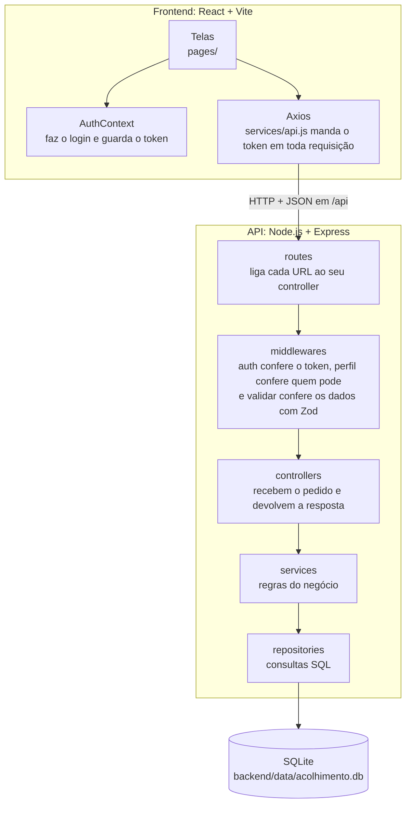
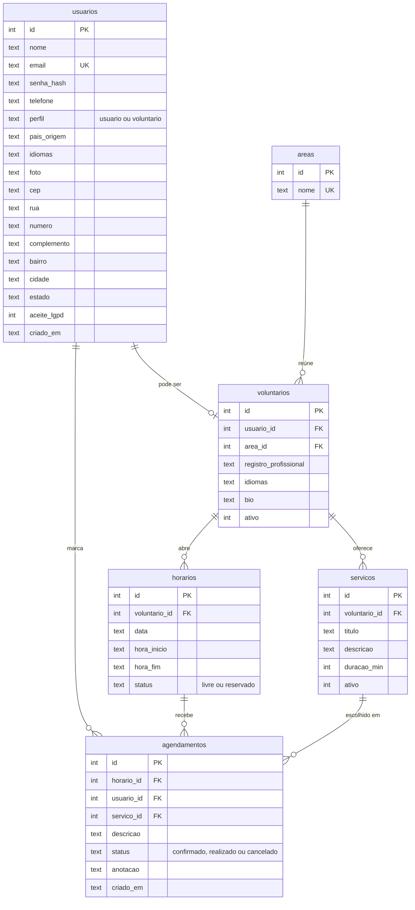

# Acolhimento Amigo

Plataforma web gratuita que conecta migrantes e refugiados a profissionais voluntários para atendimentos online: orientação jurídica, psicologia, assistência social, aulas de português, saúde, moradia e apoio para trabalho e carreira.

Projeto final do curso Full Stack da Toti, turma 58, grupo 5.

## User stories

Cada ação mostra a rota da API que ela usa. A coluna **Situação** diz em que pé está:

- **Pronto**: a tela e a API funcionam
- **Em revisão**: está no pull request aberto, esperando o merge
- **Só na API**: a rota já funciona, falta a tela

| Como um | eu posso... | | Rota da API | Situação |
| --- | --- | --- | --- | --- |
| Visitante | eu posso... | Conhecer o Acolhimento Amigo e as áreas de atendimento | Não usa a API | Pronto |
| Visitante | eu posso... | Criar uma conta como usuário para pedir atendimento | `POST /auth/cadastro` | Pronto |
| Visitante | eu posso... | Criar uma conta como voluntário informando minha área de atuação | `GET /areas`, `POST /auth/cadastro` | Pronto |
| Visitante | eu posso... | Entrar com meu e-mail e senha | `POST /auth/login` | Pronto |
| Usuário (logado) | eu posso... | Buscar voluntários por palavra-chave | `GET /voluntarios?q=` | Em revisão |
| Usuário (logado) | eu posso... | Filtrar voluntários por área, idioma e disponibilidade | `GET /voluntarios?area=&idioma=&disponivel=` | Em revisão |
| Usuário (logado) | eu posso... | Ver o perfil do voluntário com os serviços e os horários livres | `GET /voluntarios/:id` | Em revisão |
| Usuário (logado) | eu posso... | Marcar um horário livre escolhendo o serviço e contando o que preciso | `POST /agendamentos` | Em revisão |
| Usuário (logado) | eu posso... | Ver meus atendimentos marcados e os que já passaram | `GET /meus-agendamentos` | Só na API |
| Usuário (logado) | eu posso... | Remarcar um atendimento para outro horário do mesmo voluntário | `PUT /agendamentos/:id` | Só na API |
| Usuário (logado) | eu posso... | Cancelar um atendimento | `DELETE /agendamentos/:id` | Só na API |
| Usuário (logado) | eu posso... | Entrar na videochamada no dia do atendimento | Não usa a API | Falta a tela |
| Usuário (logado) | eu posso... | Editar meus dados e colocar minha foto | `GET /me`, `PUT /me` | Só na API |
| Usuário (logado) | eu posso... | Excluir minha conta | `DELETE /me` | Só na API |
| Voluntário (logado) | eu posso... | Ver no painel meu próximo atendimento e os números do mês | `GET /meus-agendamentos`, `GET /meus-horarios` | Pronto |
| Voluntário (logado) | eu posso... | Cadastrar, editar e excluir os serviços que ofereço | `GET /meus-servicos`, `POST /servicos`, `PUT /servicos/:id`, `DELETE /servicos/:id` | Pronto |
| Voluntário (logado) | eu posso... | Abrir os dias e horários em que posso atender | `POST /horarios`, `DELETE /horarios/:id` | Pronto |
| Voluntário (logado) | eu posso... | Ver minha agenda em calendário por mês, semana e dia | `GET /meus-horarios` | Pronto |
| Voluntário (logado) | eu posso... | Ver o caso e o contato de quem marcou comigo | `GET /meus-agendamentos` | Pronto |
| Voluntário (logado) | eu posso... | Concluir um atendimento escrevendo o que foi feito e o próximo passo | `PUT /agendamentos/:id` | Pronto |
| Voluntário (logado) | eu posso... | Cancelar um atendimento | `DELETE /agendamentos/:id` | Pronto |
| Voluntário (logado) | eu posso... | Ver meu histórico filtrando realizados e cancelados | `GET /meus-agendamentos` | Pronto |
| Voluntário (logado) | eu posso... | Buscar nos relatórios quem atendi por nome, data, serviço e nacionalidade | `GET /meus-agendamentos` | Pronto |
| Voluntário (logado) | eu posso... | Escolher se apareço ou não na busca | `PUT /me` | Pronto |
| Voluntário (logado) | eu posso... | Editar meus dados, foto, idiomas e apresentação | `GET /me`, `PUT /me`, `POST /areas` | Pronto |
| Voluntário (logado) | eu posso... | Excluir minha conta | `DELETE /me` | Pronto |

## Tecnologias

- Backend: Node.js, Express, Zod, bcrypt e JWT
- Banco: SQLite com better-sqlite3
- Frontend: React + Vite, React Router e Axios

## Arquitetura

O frontend em React roda no navegador e conversa com a API só por HTTP, em JSON. A API em Node.js e Express é a única parte que mexe no banco SQLite.



Se algo falha no caminho, a API para ali e responde `{ erro, detalhes }`: `401` sem token, `403` com o perfil errado, `400` com dados inválidos e `409` quando uma regra não deixa (por exemplo, horário que acabou de ser reservado).

### Fluxo de um atendimento

1. O voluntário cria a conta escolhendo a área, cadastra os serviços que oferece e abre os horários em que pode atender.
2. O usuário cria a conta e busca voluntários por palavra-chave, área, idioma e disponibilidade.
3. No perfil do voluntário, escolhe um horário livre e um serviço e conta o que precisa.
4. A API confere se o horário ainda está livre, e se o serviço é daquele voluntário. Numa única transação no SQLite, cria o agendamento como `confirmado` e muda o horário para `reservado`.
5. O voluntário vê o atendimento no painel e na agenda, com o caso e o contato da pessoa.
6. Depois da conversa, o voluntário conclui o atendimento (`realizado`) e escreve a anotação, que o usuário também lê.
7. Se um dos dois cancelar antes, o agendamento vira `cancelado` e o horário volta a ficar `livre` para outra pessoa.

## Como rodar

Precisa ter o Node.js (versão LTS) e o Git instalados.

### Primeira vez

```bash
git clone https://github.com/luisquesada26/acolhimento-amigo.git
cd acolhimento-amigo
npm run install:all
cp backend/.env.example backend/.env    # no Windows: copy backend\.env.example backend\.env
npm run db:reset
npm run dev
```

O `npm run dev` sobe as duas partes juntas:

| Parte | Endereço |
| --- | --- |
| Frontend (React) | `http://localhost:5173/login` |
| API (Express) | `http://localhost:3000/api` (teste em `/api/saude`) |

Para entrar, use um dos usuários de teste abaixo ou crie uma conta nova como usuário ou como voluntário.

### Dia a dia

1. `git checkout main` e `git pull`
2. `git checkout -b feature/nome-da-tarefa`
3. Se o `schema.sql` ou o `seed.js` mudou, rodar `npm run db:reset`. Se o `package.json` mudou, rodar `npm run install:all`
4. Programar e testar com `npm run dev`
5. `git add .`, `git commit -m "feat(xx): ..."` e `git push`
6. Abrir o pull request para a `main` e esperar a aprovação do Luis

## Banco de dados

O arquivo `.db` não vai para o GitHub. Cada pessoa gera o seu com `npm run db:reset`, que apaga as tabelas, recria tudo pelo `schema.sql` e roda o `seed.js`. Pode rodar com o servidor ligado.

O seed cria 12 áreas, 5 voluntários por área (cada um com 2 serviços e horários nas próximas 2 semanas), 5 usuários e alguns agendamentos.

As senhas são salvas com bcrypt, nunca em texto puro.

Só quem cuida do banco altera o `schema.sql`. Toda mudança vai em um pull request próprio e, depois do merge, todos rodam `npm run db:reset`.

### Tabelas

| Tabela | Colunas principais | Para que serve |
| --- | --- | --- |
| `usuarios` | `nome`, `email`, `senha_hash`, `telefone`, `perfil`, `pais_origem`, `idiomas`, `foto`, `cep`, `rua`, `numero`, `complemento`, `bairro`, `cidade`, `estado` | Todas as contas. O `perfil` diz se a pessoa é usuário ou voluntário. O endereço é opcional e só a própria pessoa vê |
| `areas` | `nome` | As áreas de atendimento: Jurídico, Psicologia, Moradia e as outras |
| `voluntarios` | `usuario_id`, `area_id`, `registro_profissional`, `idiomas`, `bio`, `ativo` | Dados profissionais de quem é voluntário. Com `ativo` desligado, não aparece na busca |
| `servicos` | `voluntario_id`, `titulo`, `descricao`, `duracao_min`, `ativo` | O que cada voluntário oferece |
| `horarios` | `voluntario_id`, `data`, `hora_inicio`, `hora_fim`, `status` | A agenda do voluntário: cada horário está `livre` ou `reservado` |
| `agendamentos` | `horario_id`, `usuario_id`, `servico_id`, `descricao`, `status`, `anotacao` | Junta quem marcou, o horário e o serviço. Fica `confirmado`, `realizado` ou `cancelado` |



### Usuários de teste

Senha de todos: `senha123`

| Perfil | E-mail |
| --- | --- |
| Usuário | `usuario@teste.com` |
| Voluntário (Jurídico) | `voluntario@teste.com` |

## Organização no GitHub

- `main`: a única branch fixa, com a versão que vai ser apresentada
- `feature/nome-da-tarefa` e `fix/nome-do-erro`: uma branch por tarefa, criada a partir da `main`
- Ninguém faz push direto na `main`. Tudo entra por pull request, e só o Luis aprova
- Na descrição do pull request, escrever `Closes #12` com o número da tarefa: no merge a tarefa fecha sozinha. Tem que ser em inglês (`Closes`, `Fixes` ou `Resolves`), o GitHub não entende `Fecha`
- Depois do merge, a branch da tarefa é apagada

### Padrão de commits

Tipo, iniciais de quem fez entre parênteses e a descrição:

```
feat(lq): cria crud de horarios
fix(lq): corrige conflito de agendamento
docs(lq): atualiza readme
refactor(lq): separa services do controller
chore(lq): atualiza dependencias
```

## API

As rotas estão em [docs/api.md](docs/api.md).

Para testar pelo VS Code, instale a extensão **REST Client**, rode `npm run dev`, abra o arquivo [backend/api.http](backend/api.http) e clique em **Send Request** em cima de cada requisição. Rode primeiro os logins: o token é usado sozinho nas rotas que precisam dele.

Para usar pelo Postman, importe a coleção [docs/acolhimento-amigo.postman_collection.json](docs/acolhimento-amigo.postman_collection.json), com `npm run dev` rodando:

- tem GET, POST, PUT e DELETE de cada tabela, uma pasta por tabela
- não precisa fazer login: antes de cada envio a coleção entra sozinha com os usuários de teste
- PUT e DELETE trabalham no que o POST da mesma pasta criou (se não tiver, a coleção cria na hora), então os dados do seed não são apagados
- depois de um `npm run db:reset`, se alguma requisição der 401 ou 404, é só mandar de novo
- quando a coleção mudar, importe de novo e escolha **Replace** para substituir a antiga

Os casos de erro (403, 409, dados inválidos) ficam no `api.http`.

## Integrantes

- Achille Landa Kintenda (al)
- Giovanni Antonio Vielma Vivas (av)
- Jesus Eduardo Oliveros Vicent (jo)
- Luis Alberto Quesada González (lq)

